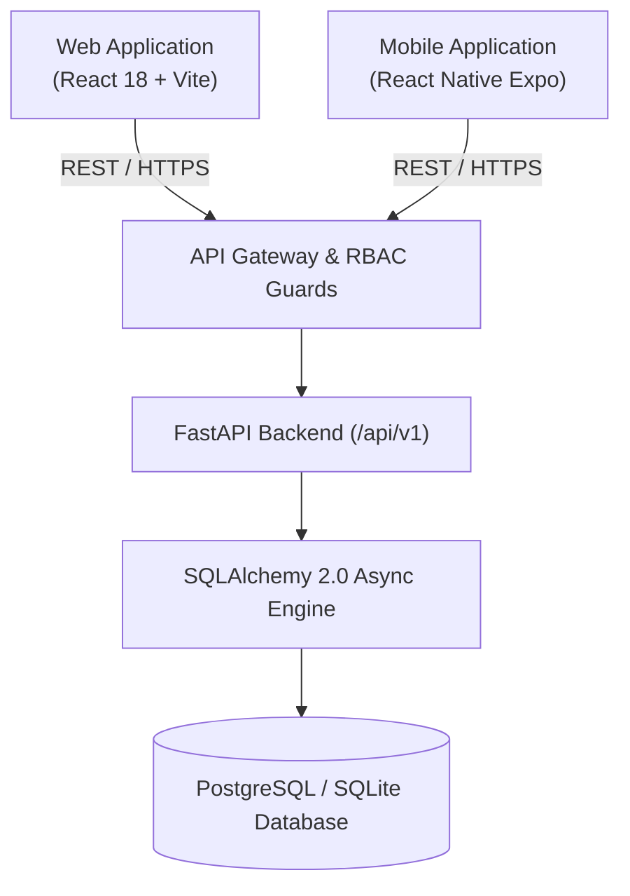

# EduVerse AI – An Intelligent, Personalized and Collaborative Education Ecosystem Using Generative AI

[](https://github.com/chaithupatel07-beep/EduVerse-AI)
[](https://fastapi.tiangolo.com)
[](https://react.dev)
[](https://expo.dev)
[](https://www.postgresql.org)

**Repository:** [https://github.com/chaithupatel07-beep/EduVerse-AI](https://github.com/chaithupatel07-beep/EduVerse-AI)

---

## 1. Abstract

EduVerse AI is a next-generation educational ecosystem engineered to unify **Students**, **Teachers**, **Parents**, and **Institution Administrators** within an integrated platform. By combining modern reactive client interfaces (Web and Mobile) with a scalable asynchronous Python backend, EduVerse AI sets the foundation for retrieval-augmented generation (RAG), personalized study pathways, and collaborative parent-teacher feedback loops.

---

## 2. Problem Statement

Contemporary educational platforms are plagued by siloed architectures:
- **Disjointed User Experiences**: Students, parents, teachers, and administrators often use disconnected tools for grades, communications, and coursework.
- **Generic Learning Material**: Standard curricula fail to adapt dynamically to an individual student's pacing and knowledge gaps.
- **Delayed Intervention**: Parents often receive academic alerts weeks after a student falls behind, missing critical windows for corrective guidance.
- **Fragmented Data**: Administrative oversight lacks unified analytics connecting attendance, engagement, and mastery metrics in real time.

---

## 3. Proposed Solution

EduVerse AI solves these challenges through an integrated 4-role architecture:
1. **Students**: Adaptive learning dashboards, 7-day streak tracking, and course practice.
2. **Teachers**: Section rosters, streamlined grading, and generative curriculum tooling.
3. **Parents**: Real-time attendance monitoring, GPA tracking, and direct teacher communications.
4. **Institution Administrators**: Campus-wide directory governance, RBAC policy enforcement, and backend health monitoring.

---

## 4. Technology Stack

| Layer | Technologies |
|---|---|
| **Web Application** | React 18, TypeScript, Vite, Tailwind CSS, React Router, Axios, Lucide Icons |
| **Mobile Application** | React Native, Expo, TypeScript, Expo Router, Axios |
| **Backend API** | Python 3.13, FastAPI, Pydantic v2, Uvicorn, REST API Architecture |
| **Database & ORM** | PostgreSQL (Primary), SQLAlchemy 2.0 Async, asyncpg, Alembic, SQLite fallback |
| **Security & Authentication** | Salted Bcrypt (12 rounds), Cryptographic HS256 JWT, RBAC guards |
| **Future Planned Integrations** | Google Gemini API (Phase 4), LangChain & ChromaDB (Phase 4), Scikit-learn (Phase 5), Firebase (Phases 2, 3, 6) |

---

## 5. Mandatory Project Directory Structure

```
EduVerse-AI/
│
├── web/                      # React 18 + TypeScript + Vite + Tailwind CSS
│   ├── src/
│   │   ├── components/       # Button, Card, ConnectionStatus, Navbar, Sidebar, RoleBadge
│   │   ├── pages/            # Login, Register, Profile, NotFound
│   │   ├── dashboards/       # FoundationDashboard, Student, Teacher, Parent, Admin
│   │   ├── services/         # Axios API client with automatic JWT interceptors
│   │   ├── hooks/            # useRoleAccess.ts
│   │   └── assets/           # Icons and visual assets
│   └── package.json
│
├── mobile/                   # React Native + Expo + TypeScript
│   ├── app/                  # Expo Router navigation routes
│   ├── components/           # Reusable Card, Button components
│   ├── services/             # Mobile API client with dynamic host resolution
│   ├── hooks/                # useMobileAuth.ts
│   ├── src/screens/          # Student, Teacher, Parent, Admin, Login screens
│   └── package.json
│
├── backend/                  # FastAPI Python backend
│   ├── app/
│   │   ├── api/v1/           # /health, /info, /db-check, /version, /auth, /users
│   │   ├── models/           # SQLAlchemy 2.0 models (User, Institution, ParentStudentLink)
│   │   ├── schemas/          # Pydantic v2 validation models
│   │   ├── services/         # AuthService, FirebaseService adapter
│   │   ├── ai/               # AI module package (Phase 4)
│   │   ├── rag/              # RAG module package (Phase 4)
│   │   └── core/             # Configuration, async DB session, security & RBAC
│   ├── alembic/              # Async database migration engine
│   ├── scripts/              # Realistic demo seed fixture generator
│   ├── tests/                # Automated pytest suite (12/12 passing)
│   ├── requirements.txt
│   └── main.py               # Application entrypoint
│
├── database/
│   └── schema.sql            # PostgreSQL DDL schema with indexes and constraints
│
├── documentation/            # Technical specifications
│   ├── architecture.md       # Full architecture diagram & component design
│   ├── phase-1.md            # Phase 1 milestones and status report
│   ├── development-setup.md  # Detailed setup and run instructions
│   ├── database-design.md    # Schema specifications and ER reference
│   └── api-documentation.md  # REST API specification
│
├── .env.example              # Clean configuration template without secrets
├── .gitignore                # Strict exclusion of credentials, caches, node_modules
├── package.json              # Monorepo root workspace configuration
├── README.md                 # Project documentation
└── start_app.bat             # One-click Windows startup script
```

---

## 6. Architecture Overview



---

## 7. Installation Instructions

### Prerequisites
- Python 3.13+ installed
- Node.js 18+ and npm installed
- Git installed

### Clone or Open the Project
```bash
cd EduVerse-AI
```

### 1. Configure Environment Variables
Copy `.env.example` to `backend/.env`:
```bash
cp .env.example backend/.env
```

---

## 8. How to Run EduVerse AI

### Option A: One-Click Startup (Windows)
Double-click `start_app.bat` or run:
```bat
start_app.bat
```

### Option B: Manual Service Launch

#### Run Backend:
```bash
cd backend
py -3.13 -m pip install -r requirements.txt
py -3.13 scripts/seed_phase1.py
py -3.13 main.py
```
- API Base: `http://localhost:8000/api/v1`
- Swagger UI: `http://localhost:8000/docs`
- Health Check: `http://localhost:8000/api/v1/health`
- Database Check: `http://localhost:8000/api/v1/db-check`

#### Run Web Application:
```bash
cd web
npm install
npm run dev
```
- Web Application: `http://localhost:5173`

#### Run Mobile Application:
```bash
cd mobile
npm install
npx expo start
```

---

## 9. Current Development Progress

| Phase | Milestone | Status |
|---|---|---|
| **Phase 1** | **Project Foundation and Architecture** | **Completed & Verified** |
| **Phase 2** | Authentication and Role Management | Awaiting Approval |
| **Phase 3** | Core Education Management | Planned |
| **Phase 4** | Generative AI and RAG Integration | Planned |
| **Phase 5** | Personalized Learning and Analytics | Planned |
| **Phase 6** | Teacher, Parent and Admin Intelligence | Planned |
| **Phase 7** | Integration, Testing and Deployment | Planned |

---

## 10. Demo Credentials (Phase 1 Seeded)

All demo accounts use password: `Password123!`

- **Student**: `student@eduverse.io` (Alex Chen)
- **Teacher**: `teacher@eduverse.io` (Dr. Sarah Jenkins)
- **Parent**: `parent@eduverse.io` (Marcus Chen)
- **Admin**: `admin@eduverse.io` (Dean Eleanor Vance)
