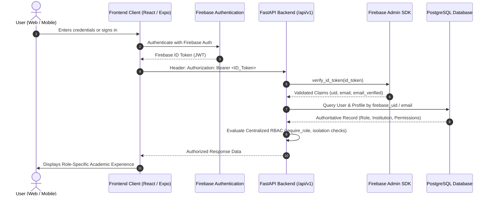

# EduVerse AI – An Intelligent, Personalized and Collaborative Education Ecosystem Using Generative AI

[](https://github.com/chaithupatel07-beep/EduVerse-AI)
[](https://fastapi.tiangolo.com)
[](https://react.dev)
[](https://expo.dev)
[](https://www.postgresql.org)
[](https://firebase.google.com)

**Repository:** [https://github.com/chaithupatel07-beep/EduVerse-AI](https://github.com/chaithupatel07-beep/EduVerse-AI)

---

## 1. Project Overview & Progress

EduVerse AI unifies **Students**, **Teachers**, **Parents**, and **Institution Administrators** into a secure, reactive, and AI-enabled educational ecosystem across both Web and Mobile platforms.

| Phase | Description | Status |
|:---:|---|:---:|
| **Phase 1** | Project Foundation, Architecture, Monorepo & GitHub Setup | Completed |
| **Phase 2** | Advanced Authentication, Role Management & Authoritative RBAC | Completed |
| **Phase 3** | Core Education Management & Course Administration | Completed |
| **Phase 4** | Generative AI, RAG & Multilingual Parent Intelligence | Completed |
| **Phase 5** | Personalized Recommendations & Academic Analytics | Completed |
| **Phase 6** | Advanced Teacher AI Copilot, Parent Consultation & Admin Intelligence | Completed |
| **Phase 7** | System Integration, Verification & Production Deployment | Planned |

---

## 2. Authentication & Authorization Architecture (Phase 2)



### Key Security Safeguards
1. **Never Trust Frontend Roles**: The client's role selection is purely navigational. Every backend endpoint inspects the authenticated token and retrieves the authoritative role directly from PostgreSQL.
2. **Dual-Token Support**: Production validates against live Firebase Admin SDK public keys (`firebase-admin` 7.8.0), while development and testing support mock tokens without requiring cloud credentials.
3. **Role-Specific Data Schemas**:
   - `student_profiles`: `student_identifier`, `department`, `academic_year`, `program`, `gpa`.
   - `teacher_profiles`: `employee_identifier`, `department`, `designation`, `specialization`, `office_hours`.
   - `parent_profiles`: `contact_number`, `occupation`, `preferred_language`.
   - `parent_student_relationships`: Verification lifecycle (`pending`, `verified`, `rejected`) requiring confirmation from the student or an administrator.
4. **Administrative Protection**: Public registration cannot self-grant Administrator status without an administrative invitation code (e.g. `EDUVERSE-ADMIN-2026`).

---

## 3. Generative AI & Multilingual Parent Intelligence (Phase 4)

- **Multilingual Parent AI Assistant (Jury Core Recommendation)**: Answers questions grounded strictly in the verified child's academic telemetry (attendance %, quiz grades, pending assignments) with zero hallucination. Supports **Telugu (`తెలుగు`)**, **Hindi (`हिंदी`)**, and **English (`English`)**.
- **Parent–Teacher–Management Communication Hub**: Categorized inquiry threads (`academic_concerns`, `attendance_issues`, `assignment_queries`, `examination_queries`, `administrative_concerns`, `general_requests`) with thread lifecycle tracking and on-demand multilingual message translation.
- **Document Ingestion & RAG**: Semantic text extraction (PDF/DOCX/TXT), sliding window chunking with overlap, persistent vector store (ChromaDB), and source-grounded answers with citations.
- **Educator AI Copilot**: Lesson plan draft generator and formative quiz authoring in English, Telugu, and Hindi.

---

## 4. Connected Ecosystem Roles

| Role | Demo Account | Default Password | Primary Responsibilities |
|---|---|---|---|
| **Student** | `student@eduverse.io` | `Password123!` | Course progress, AI study companion, practice quizzes, streak tracking |
| **Teacher** | `teacher@eduverse.io` | `Password123!` | Classroom management, generative AI quiz creation, student progress review |
| **Parent** | `parent@eduverse.io` | `Password123!` | Verified student monitoring, attendance oversight, teacher communication |
| **Admin** | `admin@eduverse.io` | `Password123!` | Campus directory, institutional RBAC policies, system health audits |

---

## 4. Quick Start & Execution Instructions

### Option A: One-Click Launch (Windows)
Run the root batch file:
```bat
start_app.bat
```
This seeds the Phase 2 database and launches the FastAPI backend and React web client simultaneously.

### Option B: Manual Service Launch

#### 1. Backend Server
```powershell
cd backend
py -3.13 scripts/seed_phase3.py
py -3.13 -m uvicorn app.main:app --reload --host 127.0.0.1 --port 8000
```
- Swagger API Docs: [http://localhost:8000/docs](http://localhost:8000/docs)
- Health Diagnostics: [http://localhost:8000/api/v1/health](http://localhost:8000/api/v1/health)

#### 2. Web Application
```powershell
cd web
npm run dev
```
- Dashboard URL: [http://localhost:5173](http://localhost:5173)

#### 3. Mobile Application (React Native / Expo)
```powershell
cd mobile
npx expo start
```

#### 4. Run Automated Tests
```powershell
cd backend
py -3.13 -m pytest -v
```
All 48 automated unit, RBAC, multi-tenant isolation, academic, AI RAG, multilingual, ML personalization, and Phase 6 intelligence test suites pass with 100% success.

---

## 5. Phase 5 – Advanced Personalized Learning & Predictive Analytics

- **Dynamic Learning Profiles**: Aggregates verified student assessment mastery, pace, streak, and topic strengths/weaknesses.
- **Deterministic Knowledge-Gap Engine**: Classifies topics into 5 states with root cause reasons and remedial guidance.
- **Scikit-Learn Predictive Pipeline**: Ridge regularized regression & Random Forest models predicting student performance trajectories with factor attributions and heuristic fallback.
- **Targeted 7-Day Study Plans**: Auto-generated revision schedules with completion tracking.
- **Curated Resource Recommendations**: Dynamic mapping between identified gaps and study materials with feedback loop.
- **Adaptive Practice Engine**: Formative quiz calibration across Beginner, Intermediate, and Advanced tiers.
- **Multilingual Parent Intelligence**: Native guidance in **Telugu (`తెలుగు`)**, **Hindi (`हिंदी`)**, and **English (`English`)**.

---

## 6. Phase 6 – Advanced Teacher AI Copilot, Parent Consultation & Admin Intelligence

- **Educator AI Copilot**:
  - **11-Section Lesson Planner**: Generates standards-aligned lesson plans with learning outcomes, 5E pedagogical flow, formative checks, and accommodations in English, Telugu, and Hindi.
  - **Question Paper & Answer Key Generator**: Multi-section exam generator (Section A MCQs, Section B Short Answer, Section C Problem Solving) with a separate answer key and marking scheme adhering to Bloom's taxonomy.
  - **Teaching Material Assistant**: Delivers real-world analogies, common misconception alerts, and differentiated explanations tailored for struggling and advanced learners.
  - **Class Remedial Teaching Guide**: Dynamically queries Phase 5 student knowledge gaps to synthesize cohort-level remedial strategies and targeted intervention groups.
- **AI-Assisted Evaluation with Teacher Safeguards**:
  - Suggests assignment marks, evaluated concept tags, and missing points from rubric criteria.
  - **Strict Ethical Safeguard**: AI suggestions remain in `suggested` status. Final grades can only be recorded through explicit teacher review and manual approval.
- **Parent Academic Intelligence & Multilingual Reports**:
  - **Verified Progress Reports**: 1-click grounded academic progress digests translated into **Telugu (`తెలుగు`)**, **Hindi (`हिंदी`)**, and **English (`English`)** reflecting verified child attendance, quiz averages, and strengths.
  - **Consultation Meeting Scheduling**: Direct parent-teacher meeting request workflow with preferred dates, time slots, Google Meet/in-person mode, and teacher confirmation.
- **Institution Admin Intelligence & Communication Analytics**:
  - Institutional intelligence reports covering campus academic health, departmental benchmarks, student retention risk, and topic gap hotspots.
  - Communication resolution analytics measuring parent inquiry resolution rates, category distributions, and staff workload allocation.
- **Real-Time Notification Engine**:
  - User in-app notification center with unread badge counters, mark-as-read, and customizable channel preferences.


