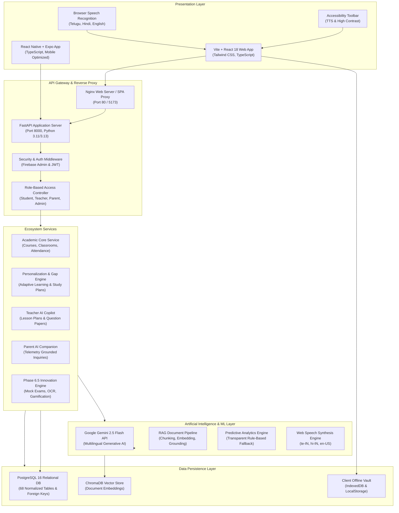

# EduVerse AI – An Intelligent, Personalized and Collaborative Education Ecosystem Using Generative AI

[](https://github.com/chaithupatel07-beep/EduVerse-AI)
[](https://fastapi.tiangolo.com)
[](https://react.dev)
[](https://expo.dev)
[](https://www.postgresql.org)
[](https://ai.google.dev)
[](https://www.docker.com)

**Repository:** [https://github.com/chaithupatel07-beep/EduVerse-AI](https://github.com/chaithupatel07-beep/EduVerse-AI)

---

## 1. Project Overview & Status

EduVerse AI unifies **Students**, **Teachers**, **Parents**, and **Institution Administrators** into a secure, reactive, and AI-enabled educational ecosystem across both Web and Mobile platforms.

| Phase | Description | Status |
|:---:|---|:---:|
| **Phase 1** | Project Foundation, Architecture, Monorepo & GitHub Setup | Completed |
| **Phase 2** | Advanced Authentication, Role Management & Authoritative RBAC | Completed |
| **Phase 3** | Core Education Management & Course Administration | Completed |
| **Phase 4** | Generative AI, RAG & Multilingual Parent Intelligence | Completed |
| **Phase 5** | Personalized Recommendations, Knowledge Gaps & Predictive Analytics | Completed |
| **Phase 6** | Advanced Teacher AI Copilot, Parent Consultation & Admin Intelligence | Completed |
| **Phase 6.5** | Innovation Ecosystem: Voice Assistant, Mock Exam Simulator, OCR Scanner, Gamification, Knowledge Map, Early Warning | Completed |
| **Phase 7** | Complete System Integration, Security Audit, Docker Deployment & Hackathon Readiness | Completed |

---

## 2. High-Level Architecture



---

## 3. Key Ecosystem Innovations

### A. Multilingual Voice AI Assistant
- Native Speech-to-Text (STT) and Text-to-Speech (TTS) in **Telugu (`te-IN`)**, **Hindi (`hi-IN`)**, and **English (`en-US`)**.
- Embedded directly in the **Student AI Tutor** and **Parent AI Companion**.

### B. AI Smart Examination Simulator
- Configurable multi-section mock exams: Multiple Choice (MCQ), True/False, Short Answer, and Descriptive.
- Live countdown timer, automatic objective scoring, and topic mastery diagnostic breakdown.

### C. Smart Notes Scanner & Grounded Doubt Solver
- OCR text extraction with student verification of formulas (e.g. $v = u + at$).
- Doubt solving strictly grounded in student notes, with note-derived formative practice quizzes.

### D. AI Smart Timetable & Pomodoro Scheduler
- Structures daily study sessions into cognitive 25–45 min Pomodoro blocks with scheduled breaks.
- Prioritizes active knowledge gaps and enables one-click rescheduling of missed sessions (+15 XP per session).

### E. Gamification & Verified Achievements
- Server-verified XP ledger (`PointTransaction`), 10 progression levels, streak tracking, milestone badges, and opt-in campus leaderboard.

### F. Visual Knowledge Map
- Interactive SVG curriculum dependency graph with color-coded mastery overlays and topic drilldowns.

### G. Intelligent Early-Warning & Intervention System
- Transparent rule-based at-risk student detection with actionable teacher remedial tracking and multilingual parent advice (EN / TE / HI).

---

## 4. Quickstart: Launch with Docker Compose

```bash
# Clone the repository
git clone https://github.com/chaithupatel07-beep/EduVerse-AI.git
cd EduVerse-AI

# Create production .env configuration
cp .env.example .env

# Build and start the full production stack
docker-compose up --build -d
```

Access the applications:
- **Web App:** `http://localhost:80` (or `http://localhost:5173` in local dev mode)
- **FastAPI Documentation:** `http://localhost:8000/docs`
- **ChromaDB Vector Store:** `http://localhost:8001`

---

## 5. Demonstration Accounts (Oakridge Global Academy)

| Role | Email | Password | Name |
|---|---|---|---|
| **Student** | `student@eduverse.io` | `Password123!` | Marcus Chen |
| **Teacher** | `teacher@eduverse.io` | `Password123!` | Dr. Sarah Jenkins |
| **Parent** | `parent@eduverse.io` | `Password123!` | David Chen |
| **Admin** | `admin@eduverse.io` | `Password123!` | Dr. Elena Rostova |

> **Evaluator Convenience:** Use the **Quick Role Switcher** dropdown in the top navigation bar to seamlessly transition between all 4 dashboards!

---

## 6. Verification & Automated Testing Evidence

- **Backend Pytest Integration Suite:**
  `py -3.13 -m pytest -v` -> **55 passed in 30.28s** (100% pass rate).
- **Frontend Production Build:**
  `npm run build` (`tsc && vite build`) -> **0 TypeScript errors, 1692 modules compiled in 4.92s**.

---

## 7. Documentation Catalog

- [SYSTEM_ARCHITECTURE.md](documentation/SYSTEM_ARCHITECTURE.md): Multi-tier architecture and micro-services.
- [DATABASE_DOCUMENTATION.md](documentation/DATABASE_DOCUMENTATION.md): Complete schema documentation for all 68 relational tables.
- [API_DOCUMENTATION.md](documentation/API_DOCUMENTATION.md): REST API reference across all routers.
- [AI_SYSTEM_DOCUMENTATION.md](documentation/AI_SYSTEM_DOCUMENTATION.md): Gemini and RAG prompt architecture and multilingual guidelines.
- [SECURITY_AUDIT.md](documentation/SECURITY_AUDIT.md): Comprehensive security evaluation and mitigation summary.
- [TESTING_REPORT.md](documentation/TESTING_REPORT.md): Automated testing report.
- [DEPLOYMENT_GUIDE.md](documentation/DEPLOYMENT_GUIDE.md): Local, containerized, cloud, and mobile deployment instructions.
- [HACKATHON_DEMO_GUIDE.md](documentation/HACKATHON_DEMO_GUIDE.md): 10-step judge's demonstration script.
- [PHASE_7_FINAL_REPORT.md](documentation/PHASE_7_FINAL_REPORT.md): Final engineering sign-off report.
