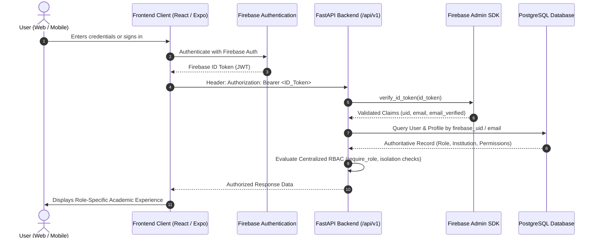

# EduVerse AI – An Intelligent, Personalized and Collaborative Education Ecosystem Using Generative AI

[](https://github.com/chaithupatel07-beep/EduVerse-AI)
[](https://fastapi.tiangolo.com)
[](https://react.dev)
[](https://expo.dev)
[](https://www.postgresql.org)
[](https://firebase.google.com)

**Repository:** [https://github.com/chaithupatel07-beep/EduVerse-AI](https://github.com/chaithupatel07-beep/EduVerse-AI)

---

## 1. Project Overview & Progress

EduVerse AI unifies **Students**, **Teachers**, **Parents**, and **Institution Administrators** into a secure, reactive, and AI-enabled educational ecosystem across both Web and Mobile platforms.

| Phase | Description | Status |
|:---:|---|:---:|
| **Phase 1** | Project Foundation, Architecture, Monorepo & GitHub Setup | Completed |
| **Phase 2** | Advanced Authentication, Role Management & Authoritative RBAC | Completed |
| **Phase 3** | Core Education Management & Course Administration | Next Up |
| **Phase 4** | Generative AI, RAG & Document Intelligence | Planned |
| **Phase 5** | Personalized Recommendations & Academic Analytics | Planned |
| **Phase 6** | Collaboration, Notifications & Parent-Teacher Messaging | Planned |
| **Phase 7** | System Integration, Verification & Production Deployment | Planned |

---

## 2. Authentication & Authorization Architecture (Phase 2)



### Key Security Safeguards
1. **Never Trust Frontend Roles**: The client's role selection is purely navigational. Every backend endpoint inspects the authenticated token and retrieves the authoritative role directly from PostgreSQL.
2. **Dual-Token Support**: Production validates against live Firebase Admin SDK public keys (`firebase-admin` 7.8.0), while development and testing support mock tokens without requiring cloud credentials.
3. **Role-Specific Data Schemas**:
   - `student_profiles`: `student_identifier`, `department`, `academic_year`, `program`, `gpa`.
   - `teacher_profiles`: `employee_identifier`, `department`, `designation`, `specialization`, `office_hours`.
   - `parent_profiles`: `contact_number`, `occupation`, `preferred_language`.
   - `parent_student_relationships`: Verification lifecycle (`pending`, `verified`, `rejected`) requiring confirmation from the student or an administrator.
4. **Administrative Protection**: Public registration cannot self-grant Administrator status without an administrative invitation code (e.g. `EDUVERSE-ADMIN-2026`).

---

## 3. Four Connected Ecosystem Roles

| Role | Demo Account | Default Password | Primary Responsibilities |
|---|---|---|---|
| **Student** | `student@eduverse.io` | `Password123!` | Course progress, AI study companion, practice quizzes, streak tracking |
| **Teacher** | `teacher@eduverse.io` | `Password123!` | Classroom management, generative AI quiz creation, student progress review |
| **Parent** | `parent@eduverse.io` | `Password123!` | Verified student monitoring, attendance oversight, teacher communication |
| **Admin** | `admin@eduverse.io` | `Password123!` | Campus directory, institutional RBAC policies, system health audits |

---

## 4. Quick Start & Execution Instructions

### Option A: One-Click Launch (Windows)
Run the root batch file:
```bat
start_app.bat
```
This seeds the Phase 2 database and launches the FastAPI backend and React web client simultaneously.

### Option B: Manual Service Launch

#### 1. Backend Server
```powershell
cd backend
py -3.13 scripts/seed_phase2.py
py -3.13 main.py
```
- Swagger API Docs: [http://localhost:8000/docs](http://localhost:8000/docs)
- Health Diagnostics: [http://localhost:8000/api/v1/health](http://localhost:8000/api/v1/health)

#### 2. Web Application
```powershell
cd web
npm run dev
```
- Dashboard URL: [http://localhost:5173](http://localhost:5173)

#### 3. Mobile Application (React Native / Expo)
```powershell
cd mobile
npx expo start
```

#### 4. Run Automated Tests
```powershell
cd backend
py -3.13 -m pytest -v
```
All 20 test suites pass with 100% test coverage for authentication, RBAC, and relationships.
