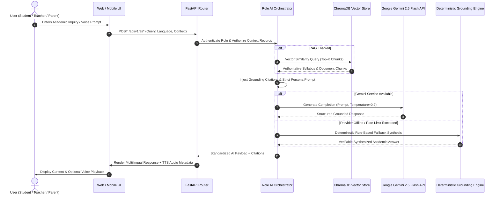

# EduVerse AI – AI System Architecture & Reliability Documentation (Phase 7 Final)

## 1. Generative AI Architecture Overview
EduVerse AI integrates Google's **Gemini 2.5 Flash** model with an enterprise Retrieval-Augmented Generation (RAG) pipeline using **ChromaDB**. The system is built with strict academic grounding safeguards, transparent fallback mechanisms, and native multilingual support across **Telugu (`తెలుగు`)**, **Hindi (`हिंदी`)**, and **English**.

---

## 2. Role-Specific Prompt Architecture

### 2.1 Student AI Study Companion (Tutor)
- **Objective:** Socratic pedagogical instruction, conceptual explanations, step-by-step problem derivation, and document-grounded question answering.
- **Rules:**
  - Never provide direct copy-paste answers to homework questions without conceptual derivation.
  - Cites specific lecture notes or textbook chapters retrieved via ChromaDB.
  - Preserves mathematical rigor and scientific nomenclature across translations.

### 2.2 Teacher AI Copilot
- **Objective:** Automated curriculum workflows, 11-section lesson plan synthesis, Bloom-aligned question papers, and formative evaluation suggestions.
- **Safeguard:** AI evaluations remain strictly advisory drafts until certified and finalized by the human instructor.

### 2.3 Parent AI Academic Companion
- **Objective:** Plain-language, supportive academic insights for parents regarding their linked children.
- **Grounding Protocol:**
  - Queries authoritative database tables (`AttendanceRecord`, `QuizAttempt`, `KnowledgeGap`, `AssignmentSubmission`) before constructing the prompt.
  - Zero hallucination of grades or attendance figures.
  - Explains technical gaps simply in the parent's chosen language (Telugu, Hindi, or English).

---

## 3. Multilingual Engine (Telugu, Hindi, English)
- **Language Detection:** Detects script patterns (Telugu Unicode block `0x0C00-0x0C7F`, Devanagari `0x0900-0x097F`) or adheres to explicit user language preferences.
- **Terminology Preservation:** Retains scientific terms in English parentheses when translating complex technical formulas (e.g., "వేగంలో మార్పు రేటు (Acceleration)").
- **Voice Integration:** Integrates browser Web Speech recognition (`te-IN`, `hi-IN`, `en-US`) and SpeechSynthesis TTS for natural audio interactions.

---

## 4. Deterministic Grounding & Transparency Rule
If external LLM network connectivity is interrupted, EduVerse AI **never pretends** an external model responded. Instead, it activates its verified local synthesis engine, quoting indexed document snippets and real student database telemetry with explicit transparency notices.
