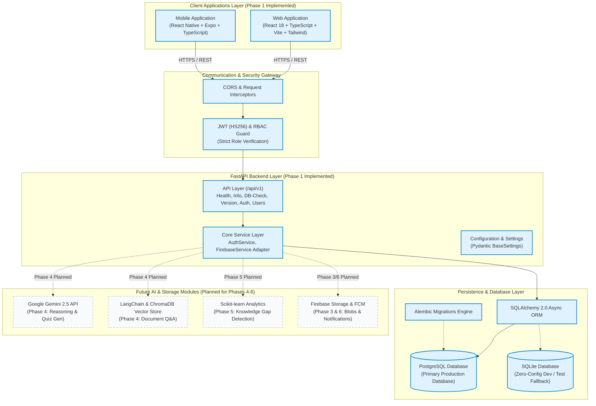

# EduVerse AI – System Architecture & Foundation Design

## 1. Executive Summary

EduVerse AI is an enterprise-grade, multi-role educational ecosystem powered by Generative AI. Designed as a unified monorepo, the platform connects **Students**, **Teachers**, **Parents**, and **Institution Administrators** across modern Web and Mobile interfaces backed by a high-performance Python FastAPI service and PostgreSQL database.

---

## 2. System Architecture Diagram

---

## 3. Layer Separation of Responsibilities

### 3.1 Client Layer (`web/` & `mobile/`)
- **Web App (`web/`)**: React 18 with Vite and TypeScript. Manages state via React Context, handles API communication using Axios interceptors with token refresh queuing, and enforces role-specific routing through `ProtectedRoute`.
- **Mobile App (`mobile/`)**: React Native with Expo and Expo Router. Reusable card and button components, dynamic environment base URL resolution (Android emulator `10.0.2.2`, physical LAN IP, or iOS simulator), and real-time backend connection status check.

### 3.2 Backend Layer (`backend/`)
- **API Routers (`app/api/v1/`)**: Versioned REST endpoints with strict Pydantic v2 validation and OpenAPI `/docs` auto-generation.
- **Service Layer (`app/services/`)**: Encapsulates business logic, token generation, user registration, and profile building, decoupled from HTTP routing.
- **Security & RBAC (`app/core/dependencies.py` & `security.py`)**: Cryptographic HS256 JWT encoding/decoding and role guards verifying permissions for the 4 roles.

### 3.3 Database Layer (`database/` & `backend/alembic/`)
- **PostgreSQL**: Primary database supporting ACID transactions, relational integrity, and indexing.
- **SQLAlchemy 2.0 Async ORM**: Fully asynchronous database queries using `asyncpg`.
- **Alembic**: Asynchronous database migration system configured with `alembic/env.py`.
