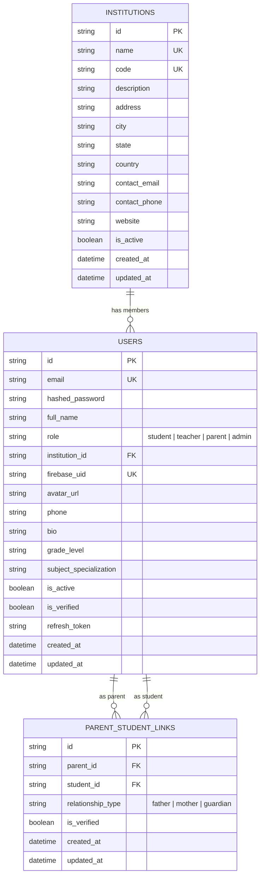

# EduVerse AI – Database Schema Documentation

## 1. Overview
The database layer uses **SQLAlchemy 2.0 Async ORM** targeting **PostgreSQL** (`postgresql+asyncpg://`) in production, with seamless zero-configuration fallback to **SQLite** (`sqlite+aiosqlite:///`) for local development and automated testing.

---

## 2. Entity-Relationship Model (Phase 1)

---

## 3. Table Specifications

### 3.1 `institutions` Table
| Column | Type | Constraints | Description |
|---|---|---|---|
| `id` | VARCHAR(36) | Primary Key | UUID v4 identifier |
| `name` | VARCHAR(255) | Unique, Index, Not Null | Full academic name |
| `code` | VARCHAR(50) | Unique, Index, Not Null | Short institution registration code |
| `description` | TEXT | Nullable | Institutional mission & description |
| `address` | VARCHAR(255) | Nullable | Street address |
| `city` | VARCHAR(100) | Nullable | City |
| `state` | VARCHAR(100) | Nullable | State / Province |
| `country` | VARCHAR(100) | Default 'Global' | Country |
| `contact_email` | VARCHAR(255) | Nullable | Official admissions or support email |
| `contact_phone` | VARCHAR(50) | Nullable | Contact telephone |
| `website` | VARCHAR(255) | Nullable | URL to institution website |
| `is_active` | BOOLEAN | Default True | Institutional active state |
| `created_at` | TIMESTAMPTZ | Not Null | Creation timestamp (UTC) |
| `updated_at` | TIMESTAMPTZ | Not Null | Last update timestamp (UTC) |

### 3.2 `users` Table
| Column | Type | Constraints | Description |
|---|---|---|---|
| `id` | VARCHAR(36) | Primary Key | UUID v4 identifier |
| `email` | VARCHAR(255) | Unique, Index, Not Null | Lowercased user login email |
| `hashed_password`| VARCHAR(255) | Nullable | Bcrypt salted hash (rounds=12) |
| `full_name` | VARCHAR(255) | Not Null | User's legal or preferred name |
| `role` | VARCHAR(20) | Index, Not Null | Role: `student`, `teacher`, `parent`, `admin` |
| `institution_id` | VARCHAR(36) | Foreign Key (`institutions.id`), Index | Affiliated institution |
| `firebase_uid` | VARCHAR(128) | Unique, Index, Nullable | Firebase Auth UID for federated login |
| `avatar_url` | VARCHAR(500) | Nullable | Profile picture URL |
| `phone` | VARCHAR(50) | Nullable | Mobile contact number |
| `bio` | TEXT | Nullable | Biography or academic statement |
| `grade_level` | VARCHAR(100) | Nullable | Student grade (e.g. "Grade 11 - STEM") |
| `subject_specialization` | VARCHAR(200) | Nullable | Teacher specialization (e.g. "Physics & AI") |
| `is_active` | BOOLEAN | Default True | Active status |
| `is_verified` | BOOLEAN | Default True | Verification status |
| `refresh_token` | TEXT | Nullable | Current valid JWT refresh token |
| `created_at` | TIMESTAMPTZ | Not Null | Timestamp created |
| `updated_at` | TIMESTAMPTZ | Not Null | Timestamp updated |

### 3.3 `parent_student_links` Table
| Column | Type | Constraints | Description |
|---|---|---|---|
| `id` | VARCHAR(36) | Primary Key | UUID v4 identifier |
| `parent_id` | VARCHAR(36) | FK (`users.id`, CASCADE), Index | Parent user ID |
| `student_id` | VARCHAR(36) | FK (`users.id`, CASCADE), Index | Student user ID |
| `relationship_type` | VARCHAR(50) | Default 'guardian' | e.g. "father", "mother", "guardian" |
| `is_verified` | BOOLEAN | Default True | Verification flag |
| `created_at` | TIMESTAMPTZ | Not Null | Timestamp created |
| `updated_at` | TIMESTAMPTZ | Not Null | Timestamp updated |
