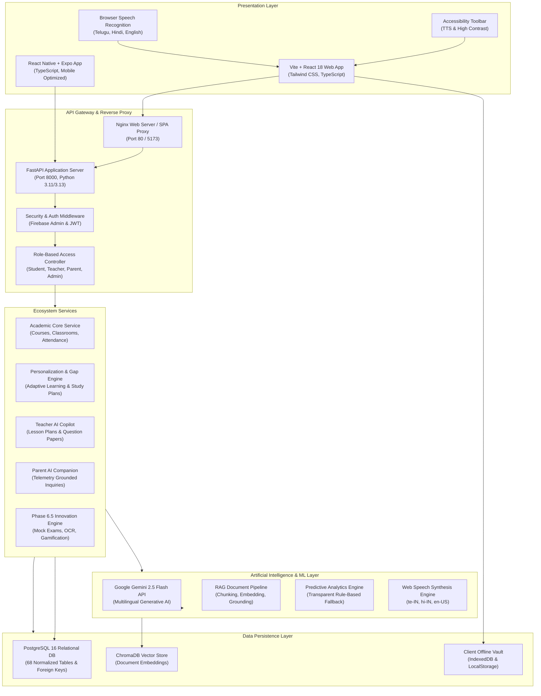

# EduVerse AI – System Architecture Documentation (Phase 7 Final)

## 1. High-Level System Overview
EduVerse AI is an enterprise-grade, intelligent, personalized, and collaborative education ecosystem engineered for modern academic institutions. It provides four specialized role-based experiences (Student, Teacher, Parent, Institution Administrator) seamlessly synchronized around a high-performance Python FastAPI backend, PostgreSQL relational database, ChromaDB vector database, and Google Gemini Generative AI infrastructure.

---

## 2. Multi-Tier Architecture Breakdown

### 2.1 Presentation Tier
- **Web Frontend (`web/`):** React 18 single-page application built with Vite, TypeScript, and Tailwind CSS. Employs modular dashboard architectures with zero page reloads, responsive layout grids, and accessible components.
- **Mobile Frontend (`mobile/`):** React Native application with Expo and TypeScript, targeting Android and iOS devices.
- **Multilingual Presentation:** Dynamically renders complete UI strings and generative outputs across **Telugu (`తెలుగు`)**, **Hindi (`हिंदी`)**, and **English**.

### 2.2 Application & Business Logic Tier
- **FastAPI Core (`backend/app/`):** Asynchronous Python application server with fully typed Pydantic v2 schemas and dependency injection.
- **Role-Based Isolation:** Guarantees strict multi-tenant boundaries between institutions and prevents unauthorized cross-role data leaks (e.g., parents can strictly access authorized linked children).
- **Service Modularization:**
  - `ai_service.py` & `rag_service.py`: Generative tutoring, syllabus indexing, and document retrieval.
  - `teacher_ai_service.py`: 11-section lesson plan generator, Bloom-aligned question papers, and remedial guides.
  - `parent_intelligence_service.py`: Real-time telemetry summaries, progress reports, and consultation scheduling.
  - `exam_simulator_service.py`: Multi-format mock exam generator with auto-grading and topic diagnostics.
  - `ocr_scanner_service.py`: Course notes ingestion, student formula correction, and grounded doubt resolution.
  - `study_scheduler_service.py`: Cognitive break-aware Pomodoro timetable generation with automatic rescheduling.
  - `gamification_service.py`: Server-verified XP progression, milestone badges, and opt-in leaderboard.
  - `intervention_service.py`: Transparent early-warning risk scoring and multilingual parent advice dispatch.

### 2.3 Data & Storage Tier
- **PostgreSQL Database:** 68 relational tables storing academic structures, user profiles, submissions, attendance logs, and innovation telemetry.
- **ChromaDB Vector Store:** Embeddings store for course handouts, textbooks, and scanned notes enabling dense semantic search.
- **Client Offline Vault:** Local storage cache enabling students in low-connectivity areas to review digitized notes and mock exams with an automatic sync queue.
