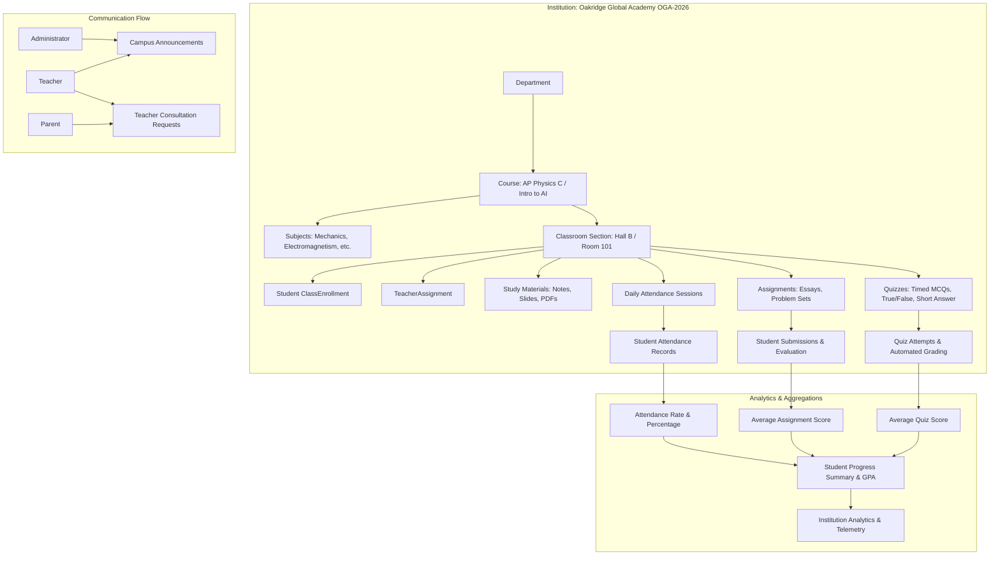
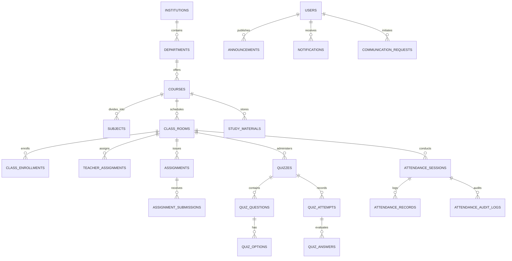

# EduVerse AI – Academic Management System Architecture (Phase 3)

## 1. Overview
Phase 3 builds the operational core of EduVerse AI, transforming it from an authenticated platform into a fully functional multi-tenant educational ecosystem. The system establishes comprehensive workflows for courses, subjects, classrooms, enrollments, study materials, assignments, quizzes, attendance tracking, student academic progress telemetry, announcements, and parent-teacher consultations.

---

## 2. Entity-Relationship & Relational Design

The academic engine uses 20 new relational database tables (Tables 9 through 28) with strong foreign keys, cascading rules, and multi-tenant scoping via `institution_id`.

---

## 3. Core Role-Based Workflows

### 3.1 Student Workflow
1. **Course Access**: Students view enrolled classrooms, credits, schedules, and instructor designations.
2. **Material Retrieval**: Students browse published study materials filtered by course or subject, with instant download streaming and RAG indexing readiness.
3. **Assignment Submission**: Students submit text responses and attachment files before the due date; late submissions are automatically flagged and timestamped.
4. **Interactive Quiz Runner**: Students take timed quizzes with an active countdown timer. Correct answers are hidden until instructors publish the results.
5. **Attendance & Progress**: Students inspect live attendance percentages, evaluation marks, teacher feedback, and aggregated GPA.

### 3.2 Teacher / Educator Workflow
1. **Classroom Roster Management**: Instructors view assigned classes, active enrollments, and student participant profiles.
2. **Study Material Publishing**: Teachers upload PDF/DOCX/PPTX notes with automated MIME verification and file size validation.
3. **Assignment Authoring & Grading**: Instructors draft and publish assignments with instructions, points, and deadlines; evaluate submissions with marks and custom feedback.
4. **Quiz Authoring**: Instructors build multi-type quizzes (MCQ, True/False, Short Answer) with points and explanations.
5. **1-Click Batch Attendance**: Instructors record daily attendance for entire classes in a single batch transaction with audit logging.
6. **Communications**: Instructors receive and respond to parent consultation requests and post role-targeted announcements.

### 3.3 Parent Workflow
1. **Context Switcher**: Parents switch between linked children to view individualized metrics.
2. **Attendance Monitoring**: Real-time breakdown of present, absent, late, and excused records with visual status indicators.
3. **Academic Progress**: Inspection of assignment completion percentages, quiz scores, and teacher remarks.
4. **Teacher Consultations**: Compose and track consultation inquiries with instructor response notes.

### 3.4 Institution Administrator Workflow
1. **Live Analytics**: Live institutional telemetry (total students, teachers, parents, courses, sections, active assignments, average attendance rate).
2. **Curriculum Administration**: Creation of academic departments, courses, credit frameworks, and subjects.
3. **Classroom Scheduling**: Section creation with room numbers, semesters, and scheduling metadata.
4. **Student Enrollment**: Manual or batch assignment of students to specific classroom cohorts.
5. **Broadcast System**: Multi-role campus notifications and announcements with priority flags (urgent, high, normal, low).

---

## 4. Security & Data Isolation
- **Tenant Scoping**: All queries filter by `institution_id` extracted from the authenticated user's JWT token.
- **Role Guards**: Backend API endpoints enforce strict RBAC via `require_teacher_or_admin`, `require_student_or_admin`, and `require_parent_or_admin`.
- **Quiz Anti-Cheat**: Quiz answer keys (`is_correct`) are filtered server-side during student queries until `results_released` is set to `True`.
- **Audit Logs**: Sensitive mutations such as attendance modifications write immutable logs with the actor's ID, old status, new status, and timestamp.
