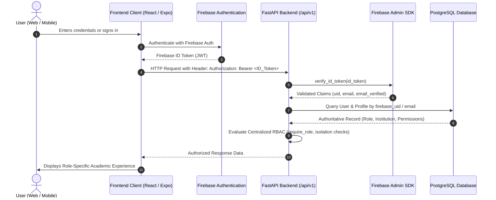
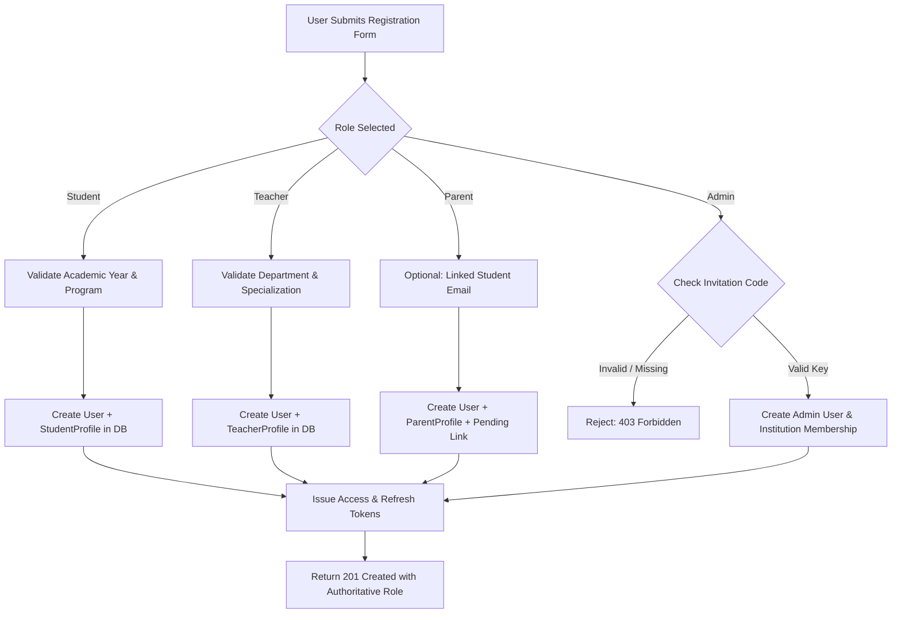

# EduVerse AI – Authentication & Authorization Architecture

## 1. High-Level Architecture

EduVerse AI utilizes a zero-trust, dual-layered authentication pipeline. Client applications authenticate identities via **Firebase Authentication**, obtain a cryptographically signed Firebase ID token (JWT), and transmit this token to the FastAPI backend. The backend verifies the token using **Firebase Admin SDK** (or local dev adapter), loads the user account from **PostgreSQL**, and authoritatively derives all user permissions and roles from the database.

---

## 2. Token Verification & Role Resolution

### Never Trust Frontend Roles
In many naive prototypes, the client sends its own role claim (e.g. `role: "admin"`). In EduVerse AI, **the backend ignores any role provided by the client when accessing protected resources**.

1. **Extraction**: `get_current_user` extracts the Bearer token from the `Authorization` header.
2. **Verification**: Token is validated against Firebase Admin SDK certificates.
3. **Database Scoping**: The user record is fetched using `selectinload` on `student_profile`, `teacher_profile`, and `parent_profile`.
4. **Authoritative Role**: `user.role` from the database is injected into route dependency handlers (`require_role`, `require_student`, `require_teacher`, `require_parent`, `require_admin`).
5. **Account Status Enforcement**: Deactivated or suspended accounts (`account_status == "suspended"`) immediately receive HTTP 403 Forbidden.

---

## 3. Registration Flow with Dynamic Profiles

