# EduVerse AI – Relational Database Design (Phase 1 & 2)

```mermaid
erDiagram
    INSTITUTIONS ||--o{ USERS : "employs / enrolls"
    INSTITUTIONS ||--o{ INSTITUTION_MEMBERSHIPS : "has"
    USERS ||--o{ INSTITUTION_MEMBERSHIPS : "belongs to"
    USERS ||--o| STUDENT_PROFILES : "has student attributes"
    USERS ||--o| TEACHER_PROFILES : "has faculty attributes"
    USERS ||--o| PARENT_PROFILES : "has guardian attributes"
    USERS ||--o{ PARENT_STUDENT_RELATIONSHIPS : "parent"
    USERS ||--o{ PARENT_STUDENT_RELATIONSHIPS : "student"

    INSTITUTIONS {
        string id PK
        string name UK
        string code UK
        string institution_type
        string official_email
        string verification_status
        boolean is_active
        timestamp created_at
    }

    USERS {
        string id PK
        string email UK
        string hashed_password
        string full_name
        string role "student | teacher | parent | admin"
        string firebase_uid UK
        string institution_id FK
        string account_status "active | suspended"
        boolean email_verified
        string avatar_url
        string phone
        text bio
        timestamp created_at
    }

    STUDENT_PROFILES {
        string id PK
        string user_id FK, UK
        string institution_id FK
        string student_identifier
        string department
        string academic_year
        string program
        float gpa
    }

    TEACHER_PROFILES {
        string id PK
        string user_id FK, UK
        string institution_id FK
        string employee_identifier
        string department
        string designation
        string specialization
        string office_hours
    }

    PARENT_PROFILES {
        string id PK
        string user_id FK, UK
        string contact_number
        string occupation
        string preferred_language
    }

    PARENT_STUDENT_RELATIONSHIPS {
        string id PK
        string parent_user_id FK
        string student_user_id FK
        string relationship_type
        string verification_status "pending | verified | rejected"
        string verified_at
        string verified_by
        text notes
    }

    INSTITUTION_MEMBERSHIPS {
        string id PK
        string institution_id FK
        string user_id FK
        string membership_role
        string status
    }

    DEPARTMENTS {
        string id PK
        string institution_id FK
        string name
        string code
    }

    COURSES {
        string id PK
        string institution_id FK
        string department_id FK
        string title
        string code
        int credits
    }

    SUBJECTS {
        string id PK
        string course_id FK
        string title
        string code
        int order_index
    }

    CLASS_ROOMS {
        string id PK
        string institution_id FK
        string course_id FK
        string name
        string academic_year
        string semester_term
    }

    CLASS_ENROLLMENTS {
        string id PK
        string class_id FK
        string student_id FK
        string status
    }

    TEACHER_ASSIGNMENTS {
        string id PK
        string class_id FK
        string teacher_id FK
        string role
    }

    STUDY_MATERIALS {
        string id PK
        string institution_id FK
        string course_id FK
        string subject_id FK
        string uploaded_by FK
        string file_name
        int file_size
        string mime_type
        boolean rag_indexed
    }

    ASSIGNMENTS {
        string id PK
        string institution_id FK
        string class_id FK
        string teacher_id FK
        string title
        int max_marks
        timestamp due_date
        string status
    }

    ASSIGNMENT_SUBMISSIONS {
        string id PK
        string assignment_id FK
        string student_id FK
        string status
        timestamp submitted_at
        float marks_obtained
        text feedback
    }

    QUIZZES {
        string id PK
        string institution_id FK
        string class_id FK
        string teacher_id FK
        string title
        int duration_minutes
        int total_marks
        boolean results_released
    }

    QUIZ_QUESTIONS {
        string id PK
        string quiz_id FK
        string question_type
        text question_text
        int points
    }

    QUIZ_OPTIONS {
        string id PK
        string question_id FK
        text option_text
        boolean is_correct
    }

    QUIZ_ATTEMPTS {
        string id PK
        string quiz_id FK
        string student_id FK
        float score
        float percentage
        boolean passed
    }

    ATTENDANCE_SESSIONS {
        string id PK
        string institution_id FK
        string class_id FK
        string teacher_id FK
        date session_date
        string session_title
    }

    ATTENDANCE_RECORDS {
        string id PK
        string session_id FK
        string student_id FK
        string status
        string remarks
    }

    ANNOUNCEMENTS {
        string id PK
        string institution_id FK
        string author_id FK
        string title
        text content
        string target_role
        string priority
    }

    COMMUNICATION_REQUESTS {
        string id PK
        string parent_id FK
        string teacher_id FK
        string student_id FK
        string subject
        text message
        string status
    }
```

## Phase 3 Academic Schema Additions (Tables 9 to 28)
1. `departments`: Institutional departments (Computer Science, Natural Sciences).
2. `courses`: Academic courses with credits and syllabi.
3. `subjects`: Discrete learning units/modules per course.
4. `class_rooms`: Specific section cohorts with term, room, and schedule.
5. `class_enrollments`: Student memberships in classroom sections.
6. `teacher_assignments`: Instructor assignments with primary/assistant roles.
7. `study_materials`: Educational assets, file metadata, download counters, and RAG indexing indicators.
8. `assignments`: Coursework assignments with deadlines and evaluation rubrics.
9. `assignment_submissions`: Student submission records with late flagging, marks, and educator feedback.
10. `quizzes`: Timed assessment frameworks with duration and passing thresholds.
11. `quiz_questions`: Multi-type question bank (MCQ, True/False, Short Answer).
12. `quiz_options`: Question options with server-side protected answer keys.
13. `quiz_attempts`: Student assessment attempts with score, percentage, and pass/fail outcome.
14. `quiz_answers`: Per-question answer telemetry with marks awarded and explanations.
15. `attendance_sessions`: Daily attendance class meetings.
16. `attendance_records`: Individual student attendance states (present, absent, late, excused).
17. `attendance_audit_logs`: Immutable audit trails for attendance adjustments.
18. `announcements`: Campus-wide notices with role targeting and priority indicators.
19. `notifications`: In-app notification queue with read state tracking.
20. `communication_requests`: Structured parent-teacher consultation requests with response notes.

