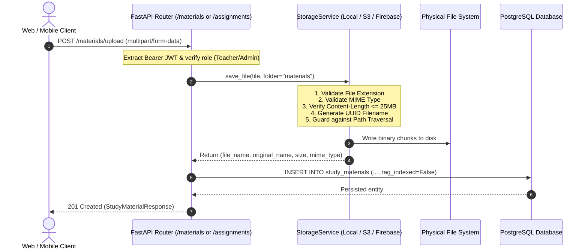

# EduVerse AI – File Storage and Document Management Architecture

## 1. Overview
The EduVerse AI file management architecture provides a secure, sandboxed, and scalable storage layer for educational assets including study notes, lecture slides, research publications, syllabus documents, and student assignment submissions.



---

## 2. Security Controls & Defensive Measures

### 2.1 Allowed MIME Types & Formats
Only explicit document types relevant to academic coursework are permitted:
| Extension | Allowed MIME Types | Maximum Size |
|-----------|--------------------|--------------|
| `.pdf` | `application/pdf` | 25 MB |
| `.docx` | `application/vnd.openxmlformats-officedocument.wordprocessingml.document` | 25 MB |
| `.doc` | `application/msword` | 25 MB |
| `.pptx` | `application/vnd.openxmlformats-officedocument.presentationml.presentation` | 25 MB |
| `.ppt` | `application/vnd.ms-powerpoint` | 25 MB |
| `.txt` | `text/plain` | 10 MB |

Any file with executable extensions (`.exe`, `.bat`, `.sh`, `.js`, `.py`, `.html`, `.php`, etc.) or non-conforming magic bytes is immediately rejected with HTTP `400 Bad Request`.

### 2.2 Path Traversal Prevention
To eliminate directory traversal attacks (such as `../../etc/passwd` or `..\windows\system32`):
1. **Filename Sanitization**: Uploaded filenames are stripped of directories using `os.path.basename` and sanitized.
2. **UUID Namespace Isolation**: Files are stored under random UUID identifiers (`<uuid4>.<extension>`) rather than user-supplied names. The original name is preserved as metadata in PostgreSQL for display purposes.
3. **Canonical Path Resolution**: The final storage path is resolved via `os.path.realpath()`, and an assertion verifies that the target resides strictly within the configured root directory (`backend/uploads/`):
   ```python
   full_path = os.path.realpath(os.path.join(upload_dir, unique_filename))
   if not full_path.startswith(os.path.realpath(upload_dir)):
       raise HTTPException(status_code=400, detail="Invalid file destination path")
   ```

### 2.3 Streaming Secure Downloads
Files are never served through arbitrary directory indices. The `/materials/{material_id}/download` endpoint:
1. Validates the user's institution tenancy.
2. Increments the `download_count` in PostgreSQL.
3. Uses `FileResponse` with `Content-Disposition: attachment; filename="..."` to stream content securely.

---

## 3. RAG AI Integration Readiness (Phase 4 Alignment)
Every uploaded study material entity includes metadata flags specifically designed for the upcoming Phase 4 RAG pipeline:
- `rag_indexed`: Boolean flag indicating whether the document has been processed by the text splitter and embedded into ChromaDB.
- `rag_chunks_count`: Integer recording the number of semantic vector chunks generated from the document.
- `rag_last_indexed_at`: Timestamp tracking embedding freshness.

This decouples document upload from vector processing, enabling background worker tasks to index materials asynchronously without blocking user uploads.
